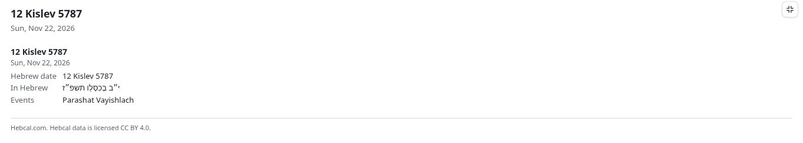

# Sacred Calendars

Look up a church season, a Hebrew date or an upcoming holy day, and put observances from both calendars on the same civil timeline.

[Connect with Claude, ChatGPT, Muse Code, or Grok](PROVIDERS.md)

Plan a community event around Passover and Easter, find the Sundays in Advent, or get candle-lighting and Havdalah times for the coming Shabbat. Calendar entries keep their own traditions and local timing, so an evening observance is easy to distinguish from the civil date printed on an invitation.

## Try it

- “When are Western Easter and Orthodox Pascha in 2027?”
- “List the major Jewish holidays in the Diaspora during April 2027 and show which overlap Holy Week.”
- “What time is candle lighting for the coming Shabbat in Chicago? Use 41.88, −87.63 and America/Chicago.”

## Get started

In Claude Code, run these commands in a session and reload plugins if prompted.

```text
/plugin marketplace add OpZero-sh/plugins
/plugin install sacred-calendars@opzero
```

In Claude chat or Cowork, open the installed plugin’s Connectors tab and connect Liturgical Year and Jewish Calendar. Both are public. The church calendar receives the date or year you ask about. Hebrew dates and holidays use the relevant date range and calendar convention. Local Shabbat times use the coordinates, time zone and candle-lighting offset you supply. City-center coordinates are sufficient for a city-level answer.

## In use

Examples from the connected services in Claude.



- [The first Sunday of Advent](media/advent.webp)
